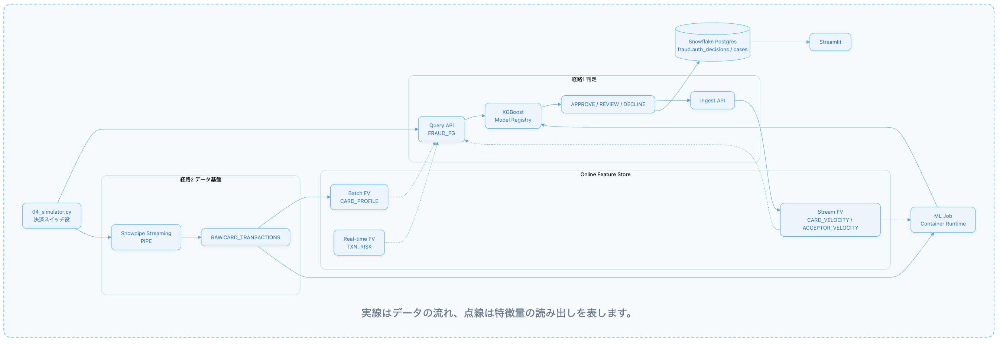
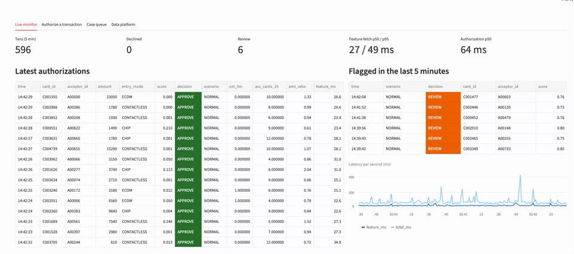

# Snowflake で作るリアルタイム不正検知デモ

*Financial Services: Real-Time Fraud Detection* のパターンを、そのまま動かせる形にしたデモです。使っているのは次の機能です。

- **Online Feature Store**（Batch・Stream・Real-time の Feature View と Feature Group）
- **Snowpipe Streaming**（High-Performance アーキテクチャ）
- **Container Runtime** 上の ML Job と **Model Registry**
- 判定ログと調査キューを置く OLTP としての **Snowflake Postgres**

データはすべて合成です。カード 5,000 枚、加盟店端末 800 台、取引は円建てで約 250 万件です。

## 構成



実線はデータの流れ、点線は特徴量の読み出しを表します。

**取り込み経路が2本ある理由。** Stream Feature View にオンラインのデータを入れる方法として、ドキュメントに載っているのは Feature Store の **Ingest REST API** だけです。Snowpipe Streaming は Stream FV の入力元としては書かれていません。そのため次のように役割を分けています。

- **Ingest API:** オーソリ判定に使う、最も新しい特徴量を作る経路。
- **Snowpipe Streaming:** 取引の全カラムを保管する経路。Batch FV、分析、再学習に使います。

## デモ画面



## 特徴量の対応

| Feature View | 種類 | 特徴量 |
|---|---|---|
| `CARD_PROFILE/V1` | Batch（1日タイル、`refresh_freq=1h`） | CARDID_COUNT_60D, CARDID_MEAN_AMOUNT_60D, CARDID_STD_AMOUNT_60D, CONTACTLESS_COUNT_90D |
| `CARD_VELOCITY/V1` | Stream（continuous 集計） | CARDID_COUNT_5M, CARDID_COUNT_1H, CARDID_SUM_AMOUNT_CONTACTLESS_4H |
| `ACCEPTOR_VELOCITY/V1` | Stream（continuous 集計） | ACCEPTORID_CARDID_COUNT_1H, ACCEPTORID_DISTINCT_CARDS_1H（`approx_count_distinct`） |
| `TXN_RISK/V1` | Real-time（`compute_fn`） | AMOUNT_TO_MEAN_RATIO, AMOUNT_ZSCORE, IS_BURST |
| `FRAUD_FG/V1` | Feature Group | 上の4つすべて。Query API 1回で取得 |

## ファイル

| ファイル | 内容 |
|---|---|
| `00_setup.sql` | ロール、Warehouse、Compute Pool、DB、生データテーブル、Snowpipe Streaming の PIPE、権限 |
| `00_postgres_oltp.sql` | Postgres の OLTP スキーマ（`fraud.auth_decisions`, `fraud.cases`, `fraud.scenario_requests`） |
| `01_generate_history.sql` | 90日分の合成履歴、約2 TPS の直近3日分、3種類の不正パターン |
| `02_feature_store.py` | Online Service（XS）、Entity、4つの Feature View、Feature Group |
| `03_train.py`, `train/` | Container Runtime 上の ML Job。Point-in-time の学習データ作成、XGBoost、Model Registry 登録、閾値の決定 |
| `fraud_auth.py` | オーソリ処理（Query API → 推論 → Postgres 書き込み → Ingest API） |
| `04_simulator.py` | 取引を生成し、経路 (1) を実行しつつ、経路 (2) で Snowpipe Streaming に送る |
| `05_app/app.py` | Streamlit のコンソール |
| `99_teardown.py` | 課金を止める（`--all` を付けると全オブジェクトを削除） |
| `tools/` | PAT の作成、Postgres スキーマの適用、Query API の疎通確認 |

## セットアップ

前提条件:

- アカウントのリージョンが AWS か Azure であること。GCP は Online Feature Store の対象外です。
- ACCOUNTADMIN 権限。
- Python 3.12。

```bash
python3 -m venv .venv && .venv/bin/pip install -r requirements.txt
```

PAT で接続するスクリプト（シミュレータ、アプリ、`FRAUD_USE_PAT=1` を付けた実行）は、環境変数 `SNOWFLAKE_ACCOUNT` のアカウント識別子を使います。

```bash
export SNOWFLAKE_ACCOUNT=<orgname>-<account_name>
```

1. ワークシートで `00_setup.sql` を実行します。
2. サービスユーザー `FRAUD_SVC` を作り、クライアントの IP を許可するネットワークポリシーを付けます。PAT はネットワークポリシーが適用されたユーザーでないと認証に使えません。続けて PAT を `~/.snowflake/fraud_svc.pat` に発行します。
   `.venv/bin/python tools/create_pat.py`
3. Postgres インスタンス `FRAUD_OLTP` を作ります（例: `BURST_S`、10GB）。`BURST_S` は AWS でしか使えないので、Azure では `BURST_M` 以上を選んでください。ネットワークポリシーには、`MODE = POSTGRES_INGRESS` のネットワークルールを含めます。接続情報はサービス名 `fraud_oltp` として `~/.pg_service.conf` と `~/.pgpass` に保存し、スキーマを適用します。
   `.venv/bin/python tools/apply_pg_sql.py`
4. `01_generate_history.sql` を実行します。
5. Feature Store を構築します。**この時点で Online Service の課金が始まります。**
   `FRAUD_USE_PAT=1 .venv/bin/python 02_feature_store.py`
6. モデルを学習し、Model Registry に登録します。
   `FRAUD_USE_PAT=1 .venv/bin/python 03_train.py`
7. シミュレータとコンソールを起動します。
   `.venv/bin/python 04_simulator.py` と `.venv/bin/streamlit run 05_app/app.py`

## デモの進め方

1. **ライブ監視。**
   - 約2 TPS の通常取引はほぼすべて APPROVE になります。
   - Feature Group の特徴量取得にかかる時間を見せます。Batch・Stream・Real-time の特徴量を REST 1回で取得しています。
2. **「Card burst」を発生させる。**
   - サイドバーのボタンで Postgres に指示が書かれ、シミュレータがそれを拾います。
   - タップのたびに `CARDID_COUNT_5M` が増えます。
   - 最初の2〜3回は通りますが、多くの場合4回目以降は DECLINE になります。
   - Ingest のたびに Stream FV が通常 200ms 程度（P50）で更新されるため、こうした判定ができます。
3. **「Compromised terminal」を発生させる。**
   - 1台の端末で `ACCEPTORID_DISTINCT_CARDS_1H` が上がり、後半のカードは DECLINE されます。
4. **1件オーソリ。**
   - 普段の利用額が 2,000〜5,000 円程度のカードで、48,000 円のタッチ決済を試します。
   - 結果は DECLINE で、SHAP による判定理由の1位は `AMOUNT_TO_MEAN_RATIO`（Real-time FV）です。
5. **調査キュー。** 担当者が Postgres（OLTP）上で、不正か誤検知かを判定します。
6. **データ基盤。**
   - 同じ取引が Snowpipe Streaming 経由で数秒後に `RAW.CARD_TRANSACTIONS` に入ります。
   - そこから Batch FV と再学習に使われます。
   - Warehouse のクエリ時間と、オンライン特徴量の取得時間を比べて見せます。

## この環境での計測結果

東京のノート PC から社内ネットワーク経由で AWS ap-northeast-1 に接続し、Online Service は XS サイズで測りました。

- `FRAUD_FG` のオンライン特徴量取得（クライアント側）: p50 で1回あたり約 25〜30ms。
- オーソリ処理全体（特徴量取得・推論・判定、クライアント側）: p50 で約 60ms。
- Snowpipe Streaming でテーブルに入るまでの遅れ: 約 6 秒。
- モデル（検証データ）: ROC AUC 0.976、PR AUC 0.785。
  - REVIEW の閾値は偽陽性率（FPR）1%、DECLINE の閾値は FPR 0.3% になるように設定しています。
  - 150 秒のライブ実行では、通常取引 300 件のうちフラグが立ったのは 1 件でした。

クライアント側のレイテンシにはネットワークの往復時間が含まれます。Query API はサーバー側の処理時間も返せます（`include_diagnostics`）。アプリの「Authorize」タブで確認できます。

## 補足と注意点

- **Container Runtime 3.0** は 2026-10-27 リリースで、アカウントごとに順次展開されています。
  - `03_train.py` は `runtime_environment="3.0"` を指定します。
  - アカウントにまだイメージがなければ既定のランタイムに切り替え、`PYPI_ACCESS_INTEGRATION` 経由で `snowflake-ml-python>=2.5` を pip でインストールします。
- **学習時の Real-time FV。**
  - この環境では、`TXN_RISK`（Real-time FV）を含めて `generate_training_set` を実行すると `invalid identifier 'TS'` で失敗しました。
  - そのため学習ジョブでは、実体化された3つの FV を結合したうえで、オンラインと*同じ* `compute_txn_risk` 関数（`train/rt_features.py`）を pandas で適用しています。オンラインとオフラインのロジックはずれません。
- **Stream 特徴量の学習と推論の整合。**
  - この環境では、オフラインの Point-in-time の学習データに、spine の時刻ちょうどのイベントは含まれていませんでした（通常取引の `CARDID_COUNT_5M` はオフラインで平均 0.02）。
  - それに合わせて、オーソリ処理では今回の取引を Ingest する*前に*特徴量を取得しています。こうすると、オンラインの値が学習時と同じ意味になります。
- **取引の密度。**
  - Velocity 特徴量は、カードや端末あたりの1時間のイベント数で値が決まります。モデルは約2 TPS で生成した直近3日分で学習しています。
  - シミュレータを大幅に速く（`--tps`）すると Velocity 特徴量が膨らみ、誤検知が増えます。
- **Stream FV のバックフィル**は Producer ロールが所有するタスクとして実行されます。このロールには `EXECUTE TASK` と `EXECUTE MANAGED TASK` の権限が必要です。権限がないとバックフィルはエラーを出さずに失敗し、オフラインの Stream 特徴量がすべて 0 になります。
- **ネットワークポリシー。** REST エンドポイントと Postgres から見えるのは、クライアントの*送信元* IP です。社内プロキシや VPN を経由すると、想定と違う IP になることがあります。許可すべき IP はエラーメッセージに表示されます。

## コストと後片付け

Online Service と Postgres インスタンスは、存在している間ずっと課金されます。

- `.venv/bin/python 99_teardown.py`: Online Service を削除し、Postgres と Compute Pool を停止します。停止でコンピュートの課金は止まりますが、ストレージの課金は残る場合があります。
- `.venv/bin/python 99_teardown.py --all`: デモで作ったオブジェクトをすべて削除します。
